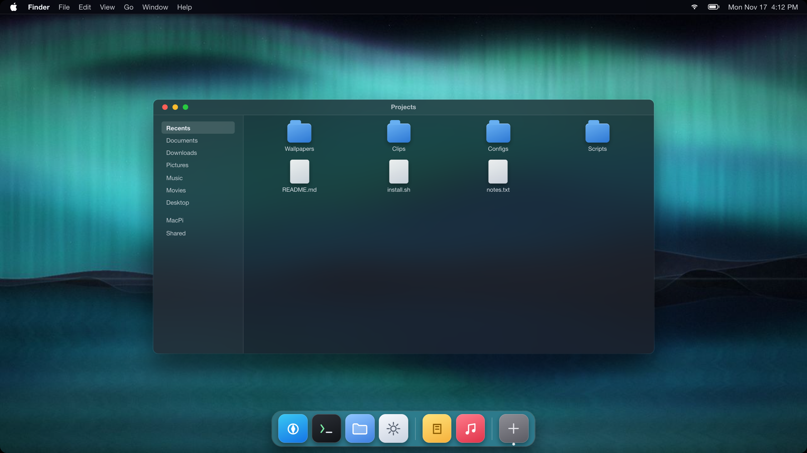

# MacPi

A clean, macOS-flavoured desktop for Raspberry Pi — menubar, dock, Spotlight,
frosted windows, and a smoothly looping nature live wallpaper on the desktop.



Runs on Raspberry Pi OS (Bookworm or newer), Pi 3 / 4 / 5 / Zero 2 W.
One installer, no image to download:

```bash
git clone https://github.com/KartBala07/MacPi.git
cd MacPi
./install.sh
sudo reboot
```

Then it boots straight into the desktop as your user — no login screen, no
stock Pi taskbar.

---

## What you get

| macOS thing | MacPi does it with |
|---|---|
| Menubar | `tint2` at the top: apple menu, active app name, tray, clock |
| Dock | `plank` at the bottom, frosted, zooming, rounded |
| Spotlight | `rofi` — **Super+Space** |
| Traffic-light window buttons | WhiteSur GTK + xfwm4, buttons on the left |
| Finder / Terminal | Thunar / xfce4-terminal, themed |
| Live wallpaper | `xwinwrap` + `mpv` drawing video on the root window |
| Mission-Control-ish window list | **Super+D** (rofi window switcher) |

Sessions: LightDM → auto-login → XFCE/X11. X11 is deliberate; plank and video
on the root window are reliable there and flaky on Wayland.

### Keyboard

| Keys | Action |
|---|---|
| `Super+Space` | Spotlight (apps) |
| `Super+D` | Window switcher |
| `Super+Return` | Terminal |
| `Super+E` | Files |
| `Super+L` | Lock |
| Middle-click a dock icon | Close the app |

---

## The live wallpaper

Two clips ship with it, both rendered from code by `tools/render_livewall.py`
(no stock footage, no licence questions):

- **aurora-lake** — aurora curtains over a mountain lake, 18 s seamless loop
- **sunrise-clouds** — sun rising over a sea of clouds, 16 s seamless loop

```bash
macpi-wallpaper list              # available clips
macpi-wallpaper set sunrise-clouds
macpi-wallpaper mode static       # back to a still frame (saves CPU)
macpi-wallpaper mode live
macpi-wallpaper status
```

Every moving element is driven by `sin(2π t)` or noise sampled on a circle in
time, so the last frame wraps to the first exactly — there is no crossfade and
no seam.

### Your own footage

Any H.264 MP4 works:

```bash
sudo cp my-loop.mp4 /usr/local/share/macpi/livewall/
macpi-wallpaper set my-loop
```

Keep it 1080p or smaller, no audio track, and looping (a crossfaded clip is
fine too). On a Pi 3 / Zero 2 the installer keeps it at 720p-ish settings; if
playback stutters use `macpi-wallpaper mode static`.

### Re-rendering the clips

```bash
pip install numpy pillow
python3 tools/render_livewall.py --scene aurora --out assets/livewall/aurora-lake-1080p.mp4
python3 tools/render_livewall.py --scene clouds --width 1280 --height 720 \
        --out assets/livewall/sunrise-clouds-720p.mp4
```

Runs anywhere with Python 3, numpy, Pillow and ffmpeg — no GPU needed.

---

## The Roku remote

If that's why you're here: **a Roku streaming-stick remote cannot be made to
control a Raspberry Pi.** Roku "point anywhere" remotes don't use Bluetooth —
they talk to the Roku over Wi-Fi Direct (802.11), a closed pairing that only a
Roku will complete. There is no adapter that changes that.

What actually works, in order of how good it feels:

1. **A cheap USB air-mouse / mini keyboard** (~$12) — plug in, done. This is
   what most people end up using.
2. **A Bluetooth media remote** — Fire TV remote, 8BitDo, generic Android TV
   remote. Pair with `bluetoothctl`, they show up as a keyboard.
3. **An IR remote + a TSOP38238 receiver** (~$1) wired to GPIO17. Any NEC-style
   remote works, including a Roku *simple* remote (the old IR-only one — test
   yours by pointing it at a phone camera and pressing a button: a purple/white
   flash means it's IR).
4. **HDMI-CEC** if the Pi is plugged into a TV: the TV's own remote (including a
   Roku TV remote) can drive the desktop.

```bash
macpi-remote detect      # what input hardware is present
macpi-remote learn-ir    # guided: press each button once, keytable is written
macpi-remote cec         # listen for HDMI-CEC keys
```

See [docs/ROKU-REMOTE.md](docs/ROKU-REMOTE.md) for the wiring diagram and the
Wi-Fi Direct explanation.

---

## Options

```bash
./install.sh --accent teal     # WhiteSur accent: blue grey purple pink red orange yellow green teal
./install.sh --no-livewall     # skip mpv/xwinwrap, still image only (lightest)
./install.sh --scale 1.5       # 144 DPI UI — good for a TV across the room
./install.sh --offline         # don't clone themes from GitHub (plain Adwaita look)
./install.sh --dry-run
```

Re-running `./install.sh` is safe — it is idempotent.

---

## Requirements

- Raspberry Pi OS **Bookworm** or newer, 32- or 64-bit (Lite is ideal — this
  installer brings its own desktop)
- Pi 3 / 4 / 5 / Zero 2 W, 2 GB RAM or more for the live wallpaper
- Network access during install (packages + themes)
- ~1.2 GB free (GTK theme build is the big part)

If you're on a **full desktop image**, the installer still works: it adds
XFCE alongside, disables the stock panel and points LightDM at the XFCE
session with auto-login.

---

## Troubleshooting

**Black screen / no dock after reboot**
```bash
Ctrl+Alt+F2                       # TTY
tint2 -c ~/.config/tint2/macpi-tint2rc & plank &
macpi-wallpaper start
journalctl -b -u lightdm --no-pager | tail -30
```

**Dock is transparent but square, no shadow** — the compositor is off:
```bash
xfconf-query -c xfwm4 -p /general/use_compositing -s true
```
On a Pi 3, turning compositing off is often the better trade.

**Wallpaper doesn't move** — check the log:
```bash
cat ~/.config/macpi/livewall.log
xdpyinfo | grep dimensions
```

**Everything is tiny on my TV** — `./install.sh --scale 1.5` (or
`macpi-settings` → Display scaling).

**Undo everything**
```bash
./uninstall.sh
```
Leaves packages and the WhiteSur themes installed; removes MacPi's session,
configs and autostart entries.

---

## Layout

```
install.sh                 one-shot installer
uninstall.sh               remove session + configs
scripts/macpi-wallpaper    live/static wallpaper control
scripts/macpi-active-app   menubar app-name provider
scripts/macpi-remote       IR / CEC / input detection
scripts/macpi-settings     rofi control centre
config/tint2/tint2rc       menubar
config/plank/              dock theme + settings
config/rofi/macpi.rasi     Spotlight theme
tools/render_livewall.py   live wallpaper renderer
assets/livewall/           the rendered loops
assets/wallpapers/         still wallpapers
```

## Credits

- [WhiteSur](https://github.com/vinceliuice/WhiteSur-gtk-theme) by vinceliuice — GTK, icon and cursor themes (GPL-3.0)
- [xwinwrap](https://github.com/ujjwal96/xwinwrap) — video on the root window
- The apple glyph is rendered from [Font Awesome](https://fontawesome.com) Brands (CC BY 4.0)
- Wallpapers and live clips are generated by `tools/render_livewall.py` in this repo (MIT)

MacPi is not affiliated with Apple or Roku. The macOS-like look is a tribute;
the trademark apple glyph is your call on your own machine.
